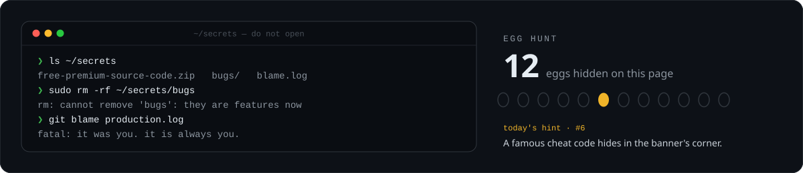

<!--

   ██████╗ ██╗   ██╗██████╗ ██╗   ██╗
  ██╔════╝ ██║   ██║██╔══██╗██║   ██║
  ██║  ███╗██║   ██║██████╔╝██║   ██║
  ██║   ██║██║   ██║██╔══██╗██║   ██║
  ╚██████╔╝╚██████╔╝██║  ██║╚██████╔╝
   ╚═════╝  ╚═════╝ ╚═╝  ╚═╝ ╚═════╝

  🥚 Egg 1/12 — you opened the source. Respect, fellow view-source enjoyer.

  Everything on this page is rendered by .github/scripts/generate_stats.py
  and refreshed by GitHub Actions every 30 minutes. No third-party stat cards.

-->

 

 

I build backend systems in **Java and Spring Boot**: auth, REST APIs, and event-driven pipelines on **Kafka and Solace**, plus the **React** dashboards that sit on top of them. I also teach Java, DSA and full-stack development to students getting ready for their first engineering job.

  
  

 

 

  

Strong fundamentals scale better than shortcuts. · Built with Python, SVG, and too much ☕

<!--
  Still here? Here's a bonus fact: the hash "c0ffee5" is fake, but the coffee is real.
  Achievement unlocked: scrolled to the bottom of a README's source. 🏆
-->
