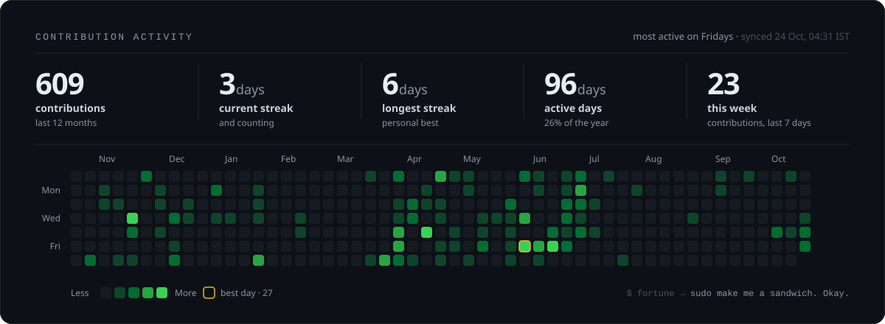
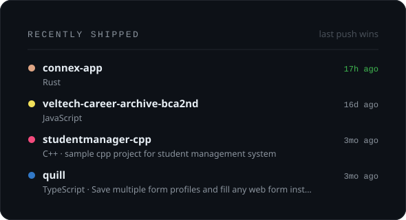

<!--

   ██████╗ ██╗   ██╗██████╗ ██╗   ██╗
  ██╔════╝ ██║   ██║██╔══██╗██║   ██║
  ██║  ███╗██║   ██║██████╔╝██║   ██║
  ██║   ██║██║   ██║██╔══██╗██║   ██║
  ╚██████╔╝╚██████╔╝██║  ██║╚██████╔╝
   ╚═════╝  ╚═════╝ ╚═╝  ╚═╝ ╚═════╝

  🥚 Egg 1/12 — you opened the source. Respect, fellow view-source enjoyer.

  Everything on this page is rendered by .github/scripts/generate_stats.py
  and refreshed by GitHub Actions every 30 minutes. No third-party stat cards.

-->

<div align="center">



<br/>

<a href="https://linkedin.com/in/gurukannan0922"></a>
<a href="mailto:gurukannan0922@gmail.com"></a>
<a href="https://github.com/gurukannan22?tab=repositories&sort=pushed"></a>


</div>

<br/>

I build backend systems in **Java and Spring Boot**: auth, REST APIs, and event-driven pipelines on **Kafka and Solace**, plus the **React** dashboards that sit on top of them. I also teach Java, DSA and full-stack development to students getting ready for their first engineering job.



<p>
  
  
</p>

<div align="center">

<br/>


<br/><br/>

<picture>
  <source media="(prefers-color-scheme: dark)" srcset="https://raw.githubusercontent.com/gurukannan22/gurukannan22/output/snake-dark.svg" />
  <source media="(prefers-color-scheme: light)" srcset="https://raw.githubusercontent.com/gurukannan22/gurukannan22/output/snake-light.svg" />
  
</picture>

</div>

<details>
<summary><b>⚠️ do not open this</b></summary>

<br/>

```console
$ sudo rm -rf /bugs
[sudo] password for guru: ********
rm: cannot remove '/bugs': they are features now

$ git blame production.log
fatal: it was you. it is always you.

$ cat /dev/motivation
☕☕☕☕☕☕☕☕☕☕☕☕☕☕☕☕☕☕☕☕☕☕ (buffer overflow)

$ echo "🥚 Egg 10/12 — you were told not to open this."
```

There is also <a href="https://www.youtube.com/watch?v=dQw4w9WgXcQ" title="🥚 Egg 11/12 — you know exactly where this goes.">📦 free-premium-source-code.zip</a> for you. No strings attached.

</details>

<details>
<summary><b>🗺️ egg hunt: 12 hidden on this page. How many can you find?</b></summary>

<br/>

| # | Hint |
|:-:|:-----|
| 1 | Real engineers read the source. |
| 2 | Point at things. |
| 3 | Check the hash of my latest commit in the terminal. What's it made of? |
| 4 | Watch the top of the banner for about a minute. Something is invading. |
| 5 | The faint 1s and 0s under the banner spell something out. |
| 6 | The bottom-right corner of the banner has a famous cheat code. |
| 7 | My status chip changes with the hour in IST. Visit at 3 a.m. Visit on a Friday afternoon. |
| 8 | Some days of the year look different. Try Halloween, April 1st, the 256th day, or December. |
| 9 | The activity card has a new fortune every day. |
| 10 | Some warnings should be ignored. |
| 11 | Free source code is never free. |
| 12 | Switch GitHub between light and dark theme and look at the footer. |

Found all twelve? Tell me on [LinkedIn](https://linkedin.com/in/gurukannan0922). You've earned bragging rights.

</details>

<div align="center">

<br/>


<sub>Strong fundamentals scale better than shortcuts. · Built with Python, SVG, and too much ☕</sub>

</div>

<!--
  Still here? Here's a bonus fact: the hash "c0ffee5" is fake, but the coffee is real.
  Achievement unlocked: scrolled to the bottom of a README's source. 🏆
-->
